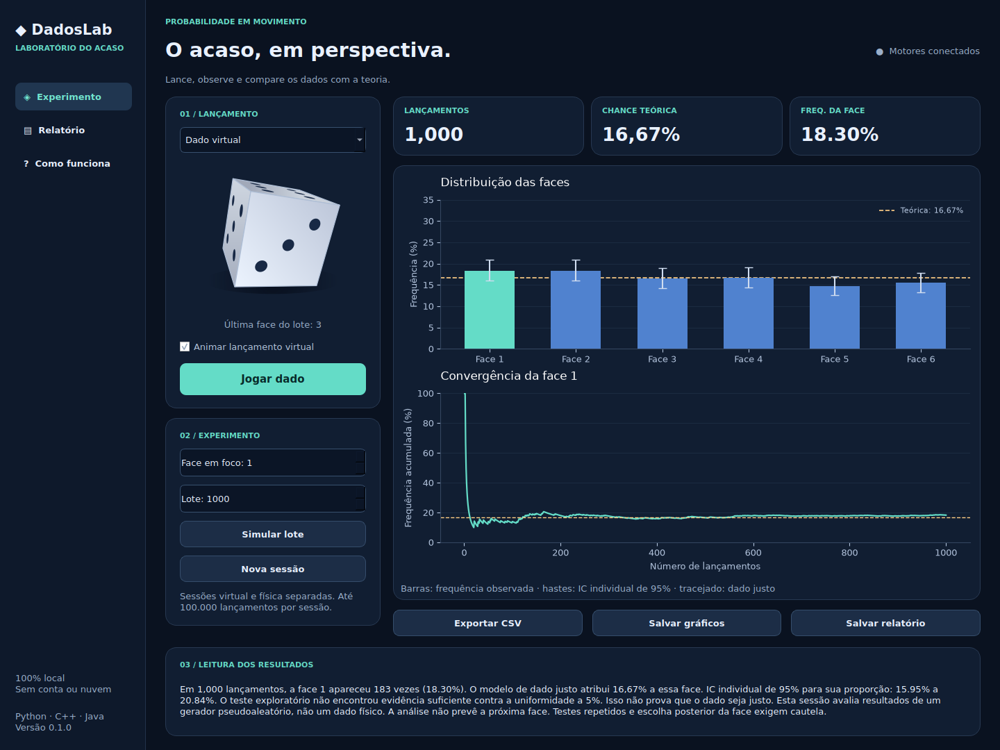

# DadosLab 0.1.0

Aplicativo desktop de probabilidade e estatística com dado virtual 3D animado, registro de dado físico, gráficos e relatório. Interface em português. Execução local, sem cadastro, servidor ou conexão após a instalação.



Captura real da interface em Linux, após 1.000 lançamentos simulados. Os resultados variam a cada sessão.

## Obter o código e o executável

```bash
git clone https://github.com/eliasramineli-sys/DadosLab.git
cd DadosLab
```

O botão **Code → Download ZIP** entrega o código-fonte. Para gerar o portátil com EXE, siga as instruções de build abaixo. O workflow [Build DadosLab](https://github.com/eliasramineli-sys/DadosLab/actions) também monta um artefato `DadosLab-Windows-x64` quando termina com sucesso; confira a execução e seus resultados na aba Actions antes de baixar. A disponibilidade depende da conclusão do workflow e das permissões do repositório.

## Abrir o pacote Windows

1. Extraia **todo** o ZIP em uma pasta do seu computador.
2. Abra `DadosLab.exe` dentro da pasta `DadosLab`.
3. Mantenha `app` e `runtime-python` junto do executável. O `.exe` é o inicializador nativo de uma distribuição portátil; não é um arquivo único independente.
4. Use **Jogar dado**, **Simular lote** ou escolha **Dado físico · registro manual**.

O pacote inclui Python, as bibliotecas científicas, o motor C++ e um runtime Java. Não exige instalar essas linguagens para o uso normal. Requer Windows 10/11 de 64 bits. Consulte `docs/VALIDACAO.md` para saber exatamente quais ambientes foram executados. Em caso de falha, `Diagnosticar.cmd` abre o aplicativo com console para exibir o erro.

## O que está implementado

- Dado 3D desenhado por projeção em perspectiva, iluminação, sombra, giro e saltos. Animação opcional.
- Uma face sorteada uniformemente por lançamento, entre 1 e 6. Em lotes, todos os resultados são registrados e só o último é mostrado no dado.
- Registro manual de lançamentos de um dado físico em sessão separada.
- Até 100.000 observações por sessão; SQLite local; criação de novas sessões sem excluir as anteriores do banco.
- Probabilidade teórica de 1/6, contagens, frequências observadas e ICs individuais exatos de 95%.
- Gráficos de distribuição e convergência da face escolhida, exportáveis em PNG.
- Média, mediana, modas, variância e desvio padrão amostrais; referências teóricas.
- Teste exploratório global de uniformidade com Pearson ou Monte Carlo multinomial em amostras esparsas.
- Entropia, maior sequência da mesma face e correlação descritiva de defasagem 1.
- Relatório explicativo em TXT e lançamentos em CSV para Excel/pandas.
- Trabalho pesado fora da thread da interface e conferência de contagens C++/Java.

## As três linguagens

| Componente | Responsabilidade real |
| --- | --- |
| Python 3.12 / PySide6 | Interface desktop, desenho do dado, coordenação, SQLite e exportações |
| NumPy / pandas | Resumos numéricos, organização de tabelas e série acumulada |
| SciPy | Intervalos exatos binomiais, qui-quadrado e referência multinomial Monte Carlo |
| Matplotlib | Gráficos e exportação PNG |
| C++20 | `mt19937_64`, distribuição uniforme discreta, geração em lotes e contagem via ABI C/ctypes |
| Java 17 | Auditoria independente de contagens, estatística de Pearson, entropia, sequências e correlação; JSON por subprocesso |

## Significado científico

Um dado justo em tentativas independentes tem P(face)=1/6 (16,67%) a cada lançamento. Ver uma face não altera retrospectivamente essa probabilidade. A frequência relativa é uma medida observada na amostra, não uma previsão da próxima face.

O modelo é pseudoaleatório, não criptográfico. A animação termina na face já sorteada; não determina o resultado por colisões físicas. Não há leitura de câmera, detecção de um dado real nem simulação física validada.

O intervalo usa Clopper–Pearson por `scipy.stats.binomtest(...).proportion_ci(method="exact")`, separadamente para cada face. Os seis intervalos não têm cobertura conjunta de 95%. A variância amostral usa n−1; para n<2 ela não é definida.

Para uniformidade, H0 contém seis probabilidades iguais e supõe independência. O programa calcula Pearson com cinco graus de liberdade quando n/6>=5 e todas as contagens observadas>=5. Nos demais casos, compara a estatística com 10.000 amostras multinomiais sob H0, com semente fixa 20261023 e p=(1+b)/(1+B). O relatório informa o método e o erro padrão Monte Carlo aproximado. A resolução Monte Carlo é limitada; não se deve interpretar o menor p possível como valor exato.

O teste é exploratório a 5%. p alto não prova que o dado seja justo; p baixo não prova fraude ou identifica causa. Repetir testes até obter significância altera a taxa de falsos alarmes. Escolher uma face depois de olhar os dados também limita a interpretação de seu intervalo. Entropia e correlação são descritivas; não constituem certificação de independência ou aleatoriedade.

## Rodar a partir do código no Windows

Pré-requisitos: Python **3.12 x64**, JDK **17+ x64** no PATH e GCC **C++20 do MSYS2 UCRT64**. Não é necessário CMake.

No PowerShell, dentro desta pasta:

```powershell
py -3.12 -m venv .venv
.\.venv\Scripts\python.exe -m pip install -r requirements-dev.txt
.\.venv\Scripts\python.exe scripts/build.py
.\.venv\Scripts\python.exe -m pytest -q
.\.venv\Scripts\python.exe main.py
```

O build procura `g++` no PATH e em `C:/msys64/ucrt64/bin/g++.exe`. Para outro local:

```powershell
.\.venv\Scripts\python.exe scripts/build.py --compiler "D:/msys64/ucrt64/bin/g++.exe"
```

O Java é invocado com o módulo `jdk.compiler`, portanto `java -version` sozinho não garante que o JDK completo esteja instalado. Se faltar esse módulo, instale um JDK, não apenas um JRE.

## Gerar o pacote com EXE

Com os pré-requisitos acima, dê dois cliques em `Gerar-EXE.cmd`, ou execute:

```powershell
powershell -NoProfile -ExecutionPolicy Bypass -File scripts/Preparar-Windows.ps1
```

O script cria ambiente Python isolado, instala dependências declaradas, compila C++/Java, roda os testes e monta `dist/DadosLab/DadosLab.exe`. O empacotamento usa um inicializador nativo Win32 e o Python embutível oficial; não usa PyInstaller nem renomeia um binário Linux para `.exe`.

A montagem requer internet para baixar o Python embutível 3.12.10, wheels Windows e JRE Zulu OpenJDK 17. O runtime Java é escolhido na API oficial Azul e sua versão/URLs e SHA-256 dos downloads são registrados no pacote. A versão 3.12.10 do Python embutível é fixa para reprodutibilidade; revise sua manutenção antes de distribuir futuras versões. O cache em `build/downloads` pode ser removido para atualizar a seleção do JRE. A construção não assina digitalmente o EXE nem cria um instalador.

## Linux para desenvolvimento

Com G++ e JDK 17+:

```bash
python3.12 -m venv .venv
.venv/bin/python -m pip install -r requirements-dev.txt
.venv/bin/python scripts/build.py
QT_QPA_PLATFORM=offscreen .venv/bin/python -m pytest -q
.venv/bin/python main.py
```

`offscreen` é apenas para testes em ambiente sem tela. Para usar a janela, execute sem essa variável e com os requisitos gráficos de Qt do seu sistema instalados. O pacote portátil fornecido tem como alvo Windows x64, não Linux/macOS.

## Dados e privacidade

No Windows, os lançamentos ficam em `%LOCALAPPDATA%/DadosLab/sessions.sqlite3`; no Linux em `~/.local/share/DadosLab/sessions.sqlite3`. O caminho usa a conta local do usuário e não contém dados de outros usuários. O aplicativo não acessa câmera, não envia telemetria e não abre portas de rede. Apenas os scripts de instalação/empacotamento baixam dependências.

O modo físico registra o que o usuário informa; não verifica se o lançamento ocorreu ou foi digitado corretamente. As sessões anteriores permanecem no SQLite, mas a interface carrega somente a sessão mais recente de cada origem. Não há importação CSV nesta versão.

## Estrutura

`dadoslab/` contém interface, visualização, estatística, persistência e integração; `native/` contém motor e inicializador C++; `java/` contém a auditoria; `scripts/` contém builds e empacotamento; `tests/` contém verificações de integração e estatística. `.github/workflows/ci.yml` prepara um build Windows e um artefato para download quando executado no GitHub; sua presença não significa que já foi executado remotamente.

Licença do código do projeto: pendente de escolha do autor. As dependências mantêm suas licenças originais. No portátil, consulte `TERCEIROS.txt`, os metadados `*.dist-info` e a pasta `legal` do Java. Qt/PySide é fornecido como bibliotecas dinâmicas substituíveis; mantenha seus avisos ao redistribuir.

## Referências

- https://docs.scipy.org/doc/scipy/reference/generated/scipy.stats.binomtest.html
- https://docs.scipy.org/doc/scipy/reference/generated/scipy.stats.chisquare.html
- https://doc.qt.io/qtforpython-6/
- https://docs.python.org/3/using/windows.html#the-embeddable-package
- https://www.azul.com/downloads/?package=jre
